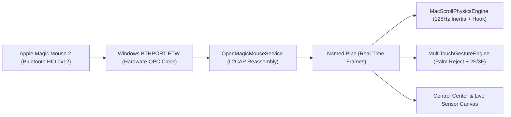

# OpenMagicMouse 2.2 — Native macOS Force-Proportional Scroll & Multi-Touch for Windows 10/11

**100% Open Source (MIT) · Zero Paid Subscriptions · Signed Apple WHQL Driver + 125Hz Inertial Physics Engine**

Bring authentic **Apple Magic Mouse 2 (`0x004C:0x0269`)** macOS trackpad-like smoothness and multi-touch multitasking gestures to Windows 10/11 — without paid third-party utilities, without disabling Secure Boot / Driver Signature Enforcement, and with full C# source transparency.

---

## Key Features / Điểm Nổi Bật

- **125Hz Force-Proportional macOS Smooth Scroll (`MacScrollPhysicsEngine`)**
  - **~27x Non-Linear Apple Acceleration Curve:** Gentle micro-rolls move line-by-line (`0.14x`) and stop cleanly on finger liftoff; strong fast flicks surge up to `3.85x` and launch velocity-adaptive exponential coasting (`τ = 310–580 ms`).
  - **Flywheel Multi-Flick Stacking & Instant Brake:** Consecutive flicks stack momentum just like macOS `NSScrollView`; touching the glass surface brakes coasting instantaneously.
  - **Fingertip Peel-Off Immunity & Hardware QPC Timing:** Uses Bluetooth controller hardware QPC timestamps (`EventHeader.TimeStamp`) and an 8-slot contact-size-aware sliding window so curved-surface liftoff never kills your flick velocity.
  - **OS Line Compensation:** Automatically calibrates across Windows `WheelScrollLines` settings (`1–6`).
- **Full Native 2- & 3-Finger Multi-Touch (`BTHPORT HCIRAW + L2CAP Reassembler`)**
  - Captures complete Bluetooth HID Report `0x12` multi-touch packets directly below `applewirelessmouse.sys` via real-time in-memory Windows ETW (`Microsoft-Windows-BTH-BTHPORT` Event `402`), reassembling fragmented `DH1` L2CAP packets for 2+ fingers with zero disk logging (`Real-time` memory trace, `0%` idle CPU).
  - Smart **Palm & Edge-Grip Rejection** ignores thumb/palm rests near mouse edges while preserving real gestures.
- **Control Center & Live Multi-Touch Visualizer (`OpenMagicMouse.exe`)**
  - Dark-mode macOS-inspired Control Center showing live touch coordinates (`id`, `x`, `y`), coasting indicator, battery level, and Windows Virtual Desktop count.
- **Optional Safari Rubber-Band Bounce Extension (`MacSafariBounceExtension`)**
  - Manifest V3 extension bringing Safari-style elastic overscroll bounce to Chrome & Edge (including SPAs like ChatGPT/Zalo/Gmail and short pages).

---

## Architecture / Kiến Trúc Hoạt Động



---

## Default macOS Gestures / Bảng Cử Chỉ Mặc Định

| Magic Mouse 2 Gesture | Default Action (Customizable) | Windows Equivalent |
|---|---|---|
| **1-Finger Scroll (Vertical / Horizontal)** | Force-proportional smooth scroll + coasting | Sub-detent `125Hz` wheel + brake |
| **1-Finger Fast Horizontal Flick** | Browser Back / Forward *(Safari style)* | `Browser Back / Forward` |
| **2-Finger Swipe Left / Right** | Switch Virtual Desktops *(Spaces)* | `Ctrl + Win + ← / →` |
| **2-Finger Double-Tap** *(or Swipe Up)* | Mission Control / Task View | `Win + Tab` |
| **2-Finger Swipe Down** | Show Desktop | `Win + D` |
| **3-Finger Tap / Click** | Middle Click *(Open link / Close tab)* | `Middle Mouse Button` |
| **3-Finger Swipe Left / Right** | Switch Windows | `Alt + Tab` |

> **Tip:** To use **2-Finger Swipe between Spaces**, make sure Windows has at least 2 Virtual Desktops (or click the **➕ Tạo Màn hình ảo thứ 2 (`Ctrl+Win+D`)** button inside the app).

---

## 2-Minute Quickstart / Cài Đặt Nhanh Trong 2 Phút

### Option A — Build & Install from Source (Recommended for Developers / Vibe Coders)
**Requirements:** Windows 10/11 (x64), paired Apple Magic Mouse 2, and [.NET 10 SDK](https://dotnet.microsoft.com/download/dotnet/10.0) (`winget install Microsoft.DotNet.SDK.10`).

1. Clone this repository:
   ```powershell
   git clone https://github.com/haikieudng-cyber/OpenMagicMouse.git
   cd OpenMagicMouse
   ```
2. Open **PowerShell as Administrator** inside the repo folder and run:
   ```powershell
   Set-ExecutionPolicy -Scope Process Bypass -Force
   .\Install-OpenMagicMouse.ps1
   ```
   The installer automatically:
   - Installs & binds Apple's signed WHQL Boot Camp driver (`AppleWirelessMouse.inf` / `.sys`) cleanly to your paired Magic Mouse 2.
   - Enables full Bluetooth HID payload tracing (`EtwLogSensitiveData = 1`) in `BTHPORT\Parameters`.
   - Builds **OpenMagicMouse 2.2**, starts `OpenMagicMouseService`, registers the high-privilege auto-start tray task (`OpenMagicMouseUI`), and puts a shortcut on your Desktop.

### Option B — Prebuilt Release Zip (No `.NET SDK` Needed)
1. Download `OpenMagicMouse-win-x64.zip` from the [**Releases**](../../releases) tab and extract it to a permanent folder (e.g. `C:\Tools\OpenMagicMouse`).
2. Run **PowerShell as Administrator** inside that folder and execute `.\Install-OpenMagicMouse.ps1`.

### Optional: Safari Rubber-Band Bounce for Chrome / Edge
Open `chrome://extensions` (or `edge://extensions`), enable **Developer mode**, click **Load unpacked**, and select the `MacSafariBounceExtension` folder. You can also test it directly by opening `MacSafariBounceExtension\SafariBounceDemo.html`.

---

## Verification & Uninstall / Kiểm Thử & Gỡ Cài Đặt

- **Run automated unit + physics + live pipe tests:**
  ```powershell
  .\OpenMagicMouse.exe --selftest --check-pipe
  ```
- **Run Safari bounce simulation tests (Node.js 20+):**
  ```powershell
  node .\Tests\verify-safari-bounce.mjs
  ```
- **Clean uninstall** *(keep Apple 1-finger driver or pass `-IncludeAppleDriver` to remove everything)*:
  ```powershell
  # PowerShell as Administrator
  .\Uninstall-OpenMagicMouse.ps1 -IncludeAppleDriver
  ```

---

## License & Attribution
Released under the [MIT License](LICENSE). Touch packet bit-packing matches the standard Linux `hid-magicmouse.c` community specification, combined with Apple's official WHQL-signed Boot Camp `AppleWirelessMouse.sys` filter driver.
